<div align="center">
  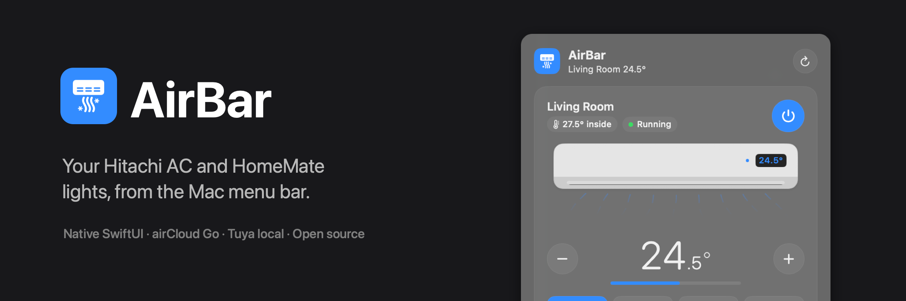

  <br />
  <br />

  <h1>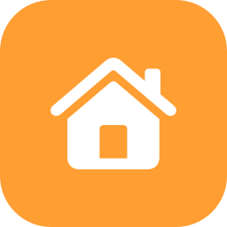 AirBar</h1>

  <p><strong>Your home, from the Mac menu bar.</strong><br />Hitachi air conditioners and HomeMate / Tuya lights and switches, in one native app.</p>

  <p>
    
    
    
    
    
    
    
  </p>

  <p><a href="https://github.com/Subham12R/airbar/releases/latest"><b>Download for macOS</b></a></p>
</div>

Click the house in your menu bar and your home is right there: your **Hitachi air conditioner** (power, temperature, mode, fan speed and swing) and your **HomeMate / Tuya lights and switches** (on/off, brightness, white tone and colour), one click each. No phone, no apps to keep open.

- **Hitachi AC**, via the same **airCloud Go** cloud service as the official app. AirBar reads your model's rules, so it **only offers settings your unit supports** and never sends one it would reject. A small live model of the unit shows what it's doing.
- **HomeMate / Tuya**, controlled **locally over your Wi-Fi**: commands go straight to the device in milliseconds, even with the internet down. A radar-style wizard pairs new devices without the HomeMate app.

> [!NOTE]
> AirBar is an independent open-source project, not affiliated with, endorsed by or supported by Hitachi, Johnson Controls-Hitachi Air Conditioning, airCloud, HomeMate or Tuya. It uses undocumented APIs that may change. See [docs/API.md](docs/API.md) (airCloud) and [docs/TUYA.md](docs/TUYA.md) (Tuya) for what's known about them.

---

##  Screenshots

<div align="center">
  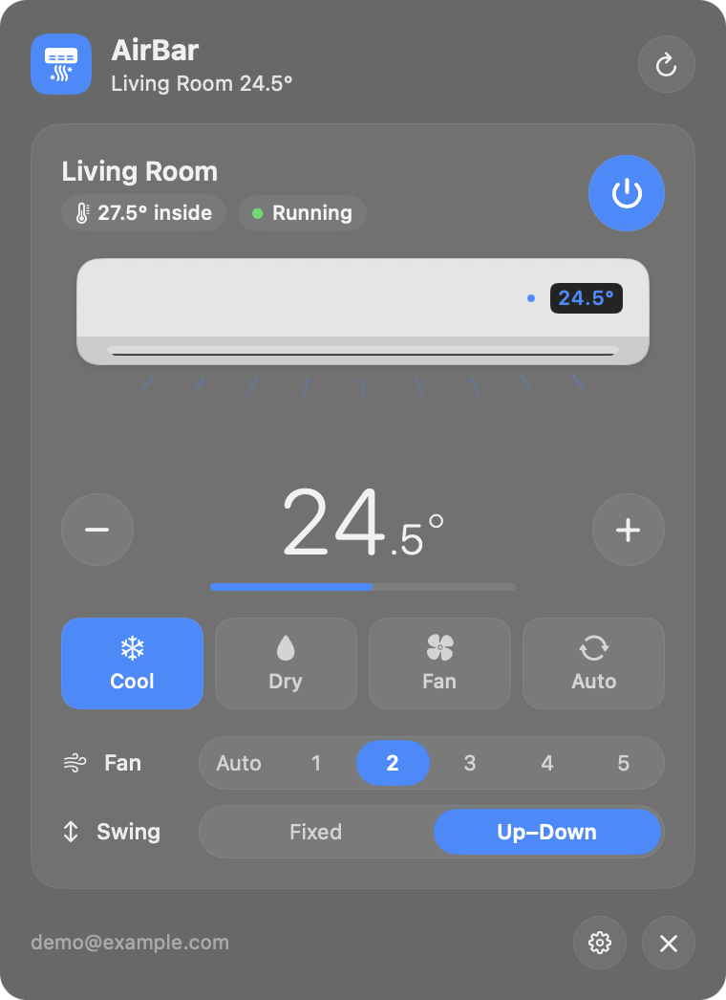
  &nbsp;
  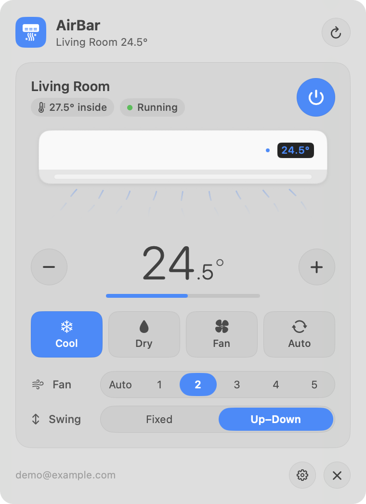
  <p><sub>Cooling at 24.5°, in dark and light mode. Temperature moves in your model's steps (here 0.5°).</sub></p>
</div>

<table>
  <tr>
    <td align="center">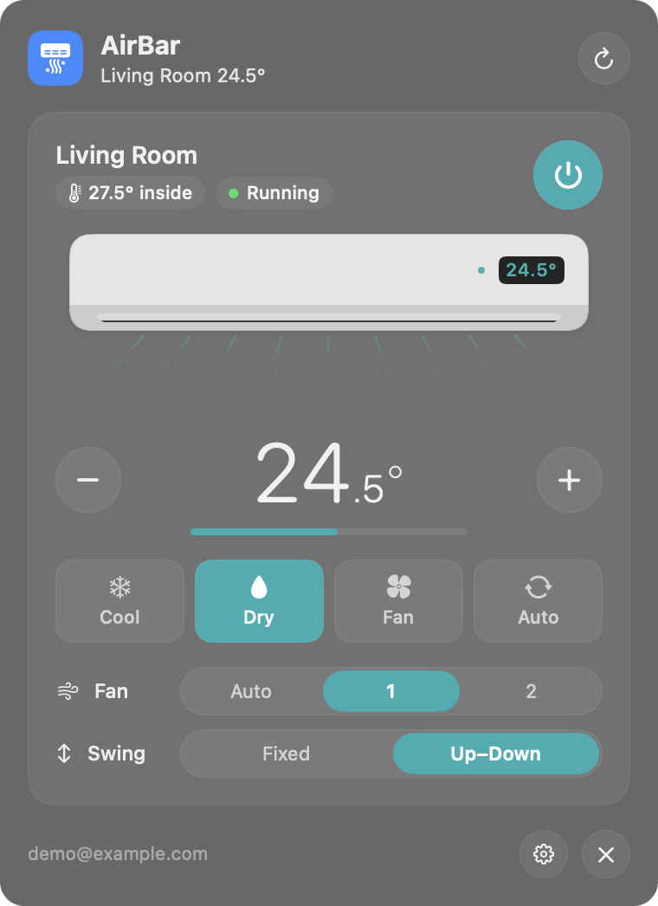<br /><sub><b>Dry.</b> Only fan levels this mode allows</sub></td>
    <td align="center">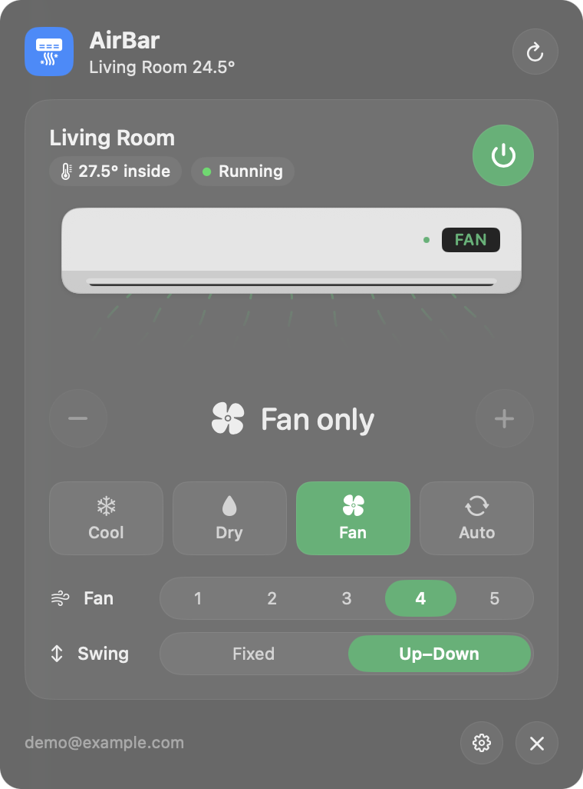<br /><sub><b>Fan.</b> No temperature, levels 1–5</sub></td>
    <td align="center">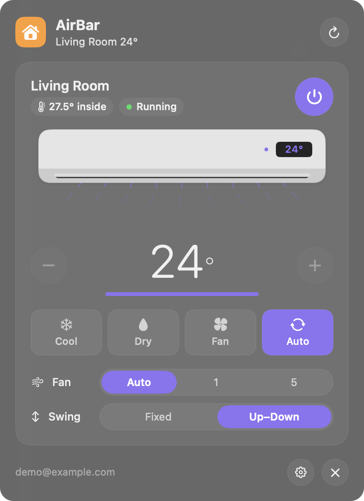<br /><sub><b>Auto.</b> The model's fixed setpoint</sub></td>
  </tr>
  <tr>
    <td align="center">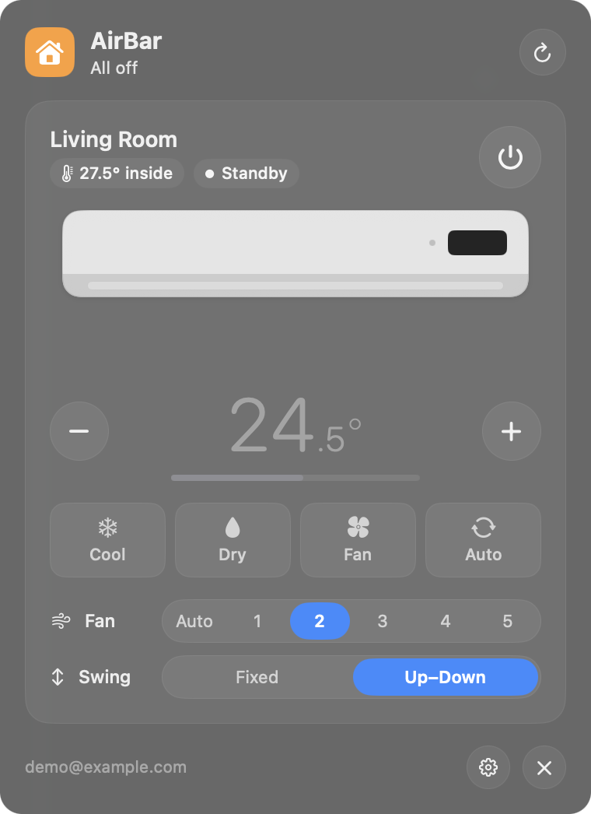<br /><sub><b>Off.</b> Louver closed, no airflow</sub></td>
    <td align="center">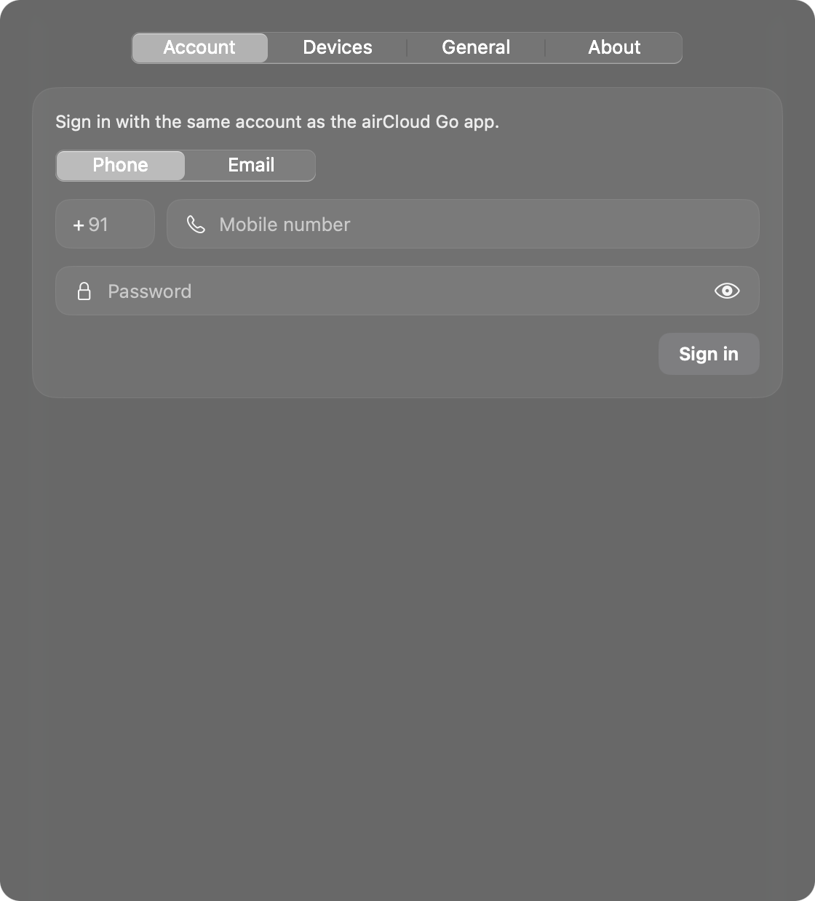<br /><sub><b>Sign in</b> with phone or email</sub></td>
    <td align="center">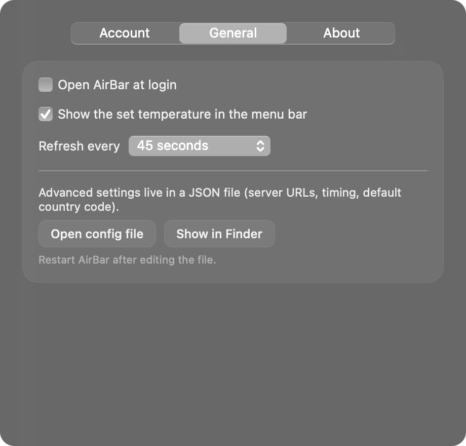<br /><sub><b>Settings.</b> Login item, menu bar, refresh</sub></td>
  </tr>
</table>

### Lights and switches

<div align="center">
  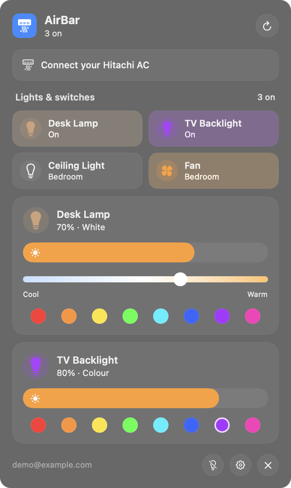
  &nbsp;
  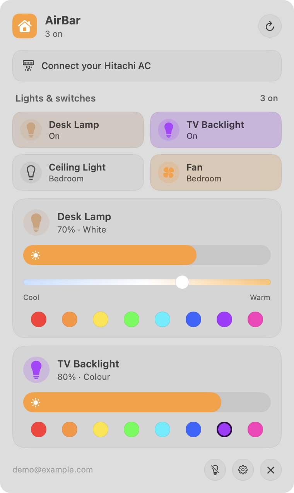
  <p><sub>A tile per switch, tinted with the light's real colour, and a card per light: brightness, white tone, colour.</sub></p>
</div>

<div align="center">
  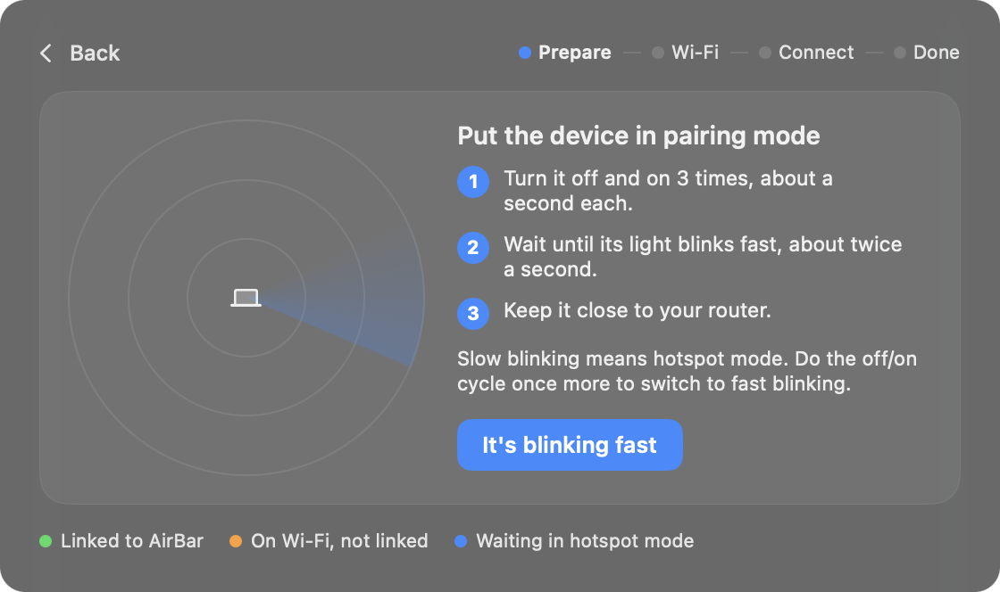
  <p><sub><b>Add a device:</b> a radar of nearby devices, then your Wi-Fi password, and AirBar pairs it.</sub></p>
  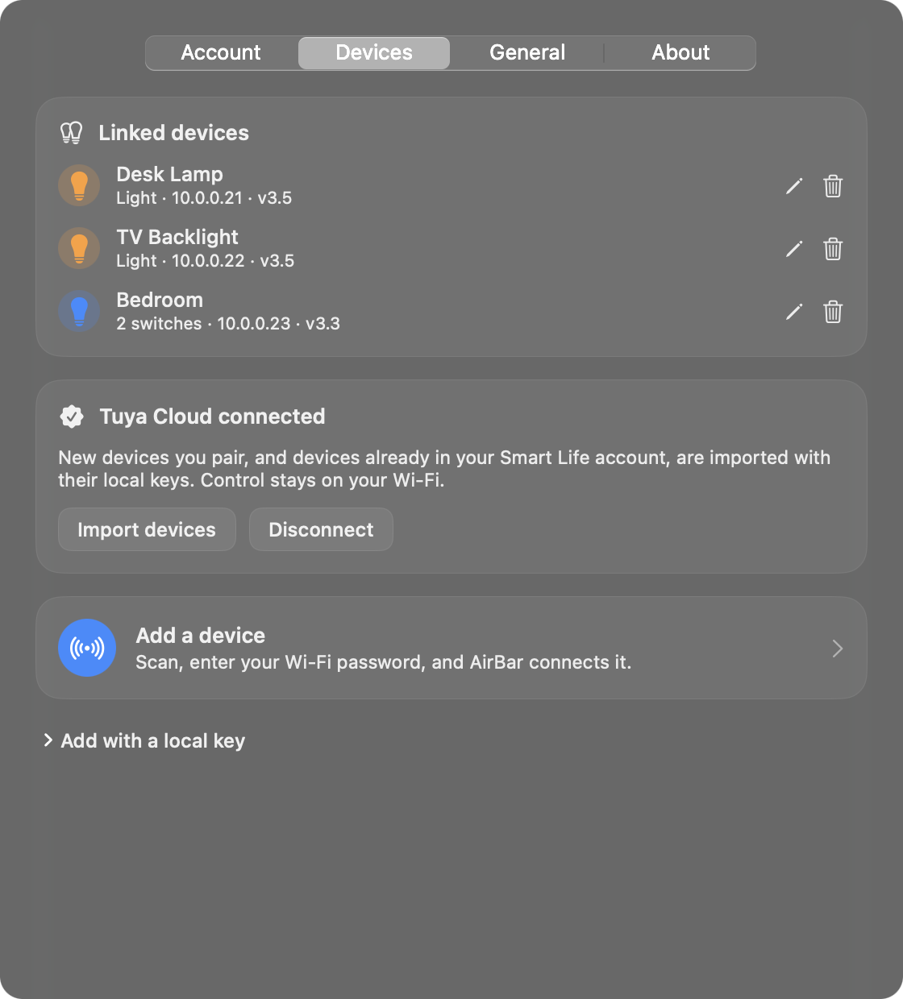
  <p><sub><b>Settings › Devices:</b> linked devices, the Tuya Cloud link, and adding devices.</sub></p>
</div>

---

##  The idea

Hitachi's cloud is picky. Every model has its own modes, fan levels, swing axes and temperature steps; it answers **400** for anything outside them and **429** if a second command arrives before the first is done. A quick remote that just fires requests feels broken. AirBar gets three things right instead:

### 1️⃣ Read the model *(what's allowed)*
On sign-in AirBar fetches each unit's model configuration (`rac-configuration`): which modes exist, the temperature range and step per mode, which fan levels each mode accepts, which swing axes the louver has. The card is built from that, so a cooling-only unit never shows Heat and Fan mode never shows Auto.

> Cached on disk · one request per model · no personal data in the cache

### 2️⃣ Fit every command *(no 400s)*
Before anything is sent, the desired state is fitted to the model's rules: temperature snapped to the step and clamped to the range, a fan level the new mode doesn't allow swapped for that mode's default, an unsupported swing axis mapped to one that exists. The fitting is pure and unit-tested.

> 23.3° → 23.5° · Dry + fan 4 → Auto · "All" swing on a vertical-only louver → Up–Down

### 3️⃣ One at a time *(no 429s)*
Taps change the card instantly, then a per-unit queue merges a burst of taps into **one** command carrying the full state, waits for airCloud to accept it, pauses briefly, and only then sends whatever changed meanwhile. A file lock keeps the app and the CLI in line too.

> Tap + five times → one command for the final temperature · busy units are retried with back-off

### 💡 And lights stay local *(HomeMate / Tuya)*
HomeMate's switches and bulbs are Tuya hardware. AirBar speaks Tuya's encrypted LAN protocol (3.3, 3.4 and 3.5, with the session-key handshake) directly to each device on port 6668, so a tap is a few milliseconds on your own network. The cloud is used once to fetch each device's local key, and to pair new ones.

> Strips that say `colour_data` but speak the v2 format are detected · brightness follows the colour value in colour mode · devices that change IP are found again from their broadcasts

---

##  Architecture

One small Swift package: two libraries (airCloud and Tuya), the menu bar app, and a CLI. No helper processes, no Python, no third-party packages.

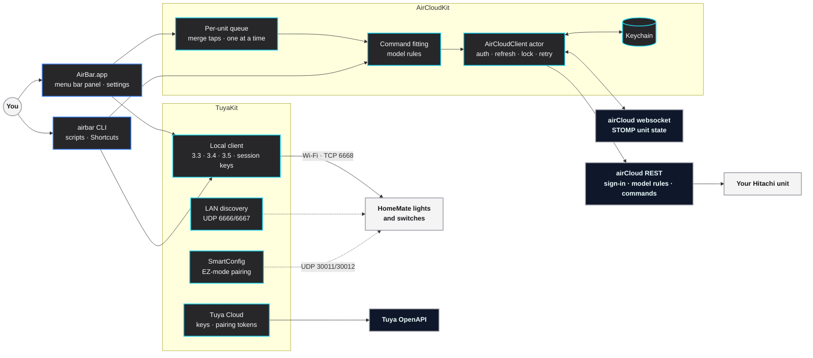

---

##  Features

| Feature | Description |
| :--- | :--- |
| ** One-click control** | Power, temperature, mode, fan and swing straight from the menu bar |
| ** Model-aware** | Shows only the modes, fan levels, swing axes and temperature range your unit supports |
| ** No rejected commands** | Every command is fitted to the model's rules before it's sent |
| ** Command queue** | Rapid taps merge into one command; units that are still busy are retried, never flooded |
| ** A live model** | The louver opens and sweeps, and airflow follows mode colour and fan speed |
| ** At a glance** | A house in the menu bar: filled while the AC or any light is on, with the AC's set temperature beside it |
| ** Phone or email sign-in** | Same login as airCloud Go; phone accounts use the app's own `mobileNumber` sign-in |
| ** Keychain** | Password and session tokens live in the macOS Keychain, on this Mac only |
| ** Multiple units** | One card per indoor unit in your airCloud home |
| ** Lights and switches** | HomeMate / Tuya on/off, brightness, white tone and colour, locally over Wi-Fi |
| ** Pairing wizard** | A radar of nearby devices, your Wi-Fi password, done; no HomeMate app needed |
| ** Works offline** | Lights keep working when the internet is down; devices that change IP are found again |
| ** CLI** | `airbar` for scripts, Shortcuts, Raycast and Alfred, sharing the app's sign-in and queue |
| ** Native and light** | SwiftUI, a couple of MB, no dependencies, no telemetry |

---

##  Controls

| Control | Does |
| :--- | :--- |
| **Power button** | Turns the unit on or off |
| **− / +** | Target temperature, in your model's steps and range |
| **Mode** | Cool, Heat, Dry, Dry Cool, Fan, Auto (only the ones your unit has) |
| **Fan** | Auto or levels 1–5 (only the ones the current mode allows) |
| **Swing** | Fixed, Up–Down, Side, All (only the axes your louver has) |
| **Refresh** | Re-reads every unit now (it also refreshes on its own, every 45 s by default) |
| **Light tile** | Turns a light or switch on or off; multi-gang boards get a tile per switch |
| **Light card** | Brightness, white tone (cool to warm) and colour swatches, for lights that support them |
| **Bulb with a slash** | Turns off every light and switch |
| **Gear** | Settings: account, devices, login item, menu bar temperature, refresh interval, config file |

**Updating…** on a card means a change is on its way to airCloud.

---

##  Command line

| Command | What happens |
| :--- | :--- |
| `airbar login --phone 9XXXXXXXXX` | Asks for your password (hidden) and signs in with a phone account; `--country 91` is the default |
| `airbar login --email you@example.com` | Same, for an email account |
| `airbar status` | `Living Room: on, cooling 24.5°, fan 2, swing vertical, room 27.5°` |
| `airbar status --json` | Full state of every unit, including its model capabilities |
| `airbar on` · `off` · `toggle` | Power; with several units add `--unit "Living Room"` |
| `airbar set --temp 24.5 --mode cool --fan 2 --swing vertical` | Any mix of settings in one command, fitted to the model |
| `airbar logout` | Signs out and removes the credentials from the Keychain |
| `airbar devices` | `Desk Lamp: on, 70%, white 65% warm` for every light and switch |
| `airbar light "Desk Lamp" on --brightness 40 --warmth 80` | Power, brightness, white tone; `--hue 230` for a colour |
| `airbar switch Bedroom toggle --dp 2` | One switch of a multi-gang board; `--all` for every switch |
| `airbar scan` | Tuya devices broadcasting on your Wi-Fi, and which are linked |
| `airbar tuya connect --id ACCESS_ID --region in` | Links your Tuya project (asks for the secret) and imports devices with their keys |
| `airbar tuya add --id DEVICE_ID --name "Desk Lamp"` | Adds a device with a local key you already have |
| `airbar pair --ssid HomeWiFi` | Pairs devices in EZ mode (asks for the Wi-Fi password) |
| `airbar config` | Prints the config file's path and contents |

The CLI shares the app's Keychain sign-in, config and command lock, so they never step on each other.

---

##  Install a build

1. Download `AirBar-<version>.zip` from the [latest release](https://github.com/Subham12R/airbar/releases/latest), unzip it, and drag **AirBar.app** to Applications.
2. Open AirBar. The build isn't notarized yet, so macOS blocks the first launch: go to **System Settings › Privacy & Security** and click **Open Anyway** (or right-click AirBar › Open).
3. Click the house in the menu bar › **Sign in** for your AC (same phone number or email as airCloud Go), and/or **Add lights & switches**.

### HomeMate / Tuya setup (once)

The HomeMate app won't share devices with other apps, so AirBar uses a free Tuya developer project to get each device's local key:

1. Create a Cloud project at [iot.tuya.com](https://iot.tuya.com/cloud/) (Smart Home, your region's data center).
2. In the project, **Devices › Link App Account**, and scan the QR code with the **Smart Life** app.
3. In AirBar, **Settings › Devices › Connect Tuya Cloud**: paste the project's Access ID and Secret. Devices in your Smart Life account are imported.
4. For new devices, use **Add a device**: put the device in pairing mode (it blinks fast), enter your 2.4 GHz Wi-Fi password, and AirBar does the rest.

Already have a device's local key? **Settings › Devices › Add with a local key**. Details: [docs/TUYA.md](docs/TUYA.md).

Optional: put the CLI on your `PATH` with `sudo install -m 755 airbar /usr/local/bin/airbar`.

Check a download against its checksum with `shasum -a 256 -c AirBar-<version>.zip.sha256`.

---

##  Build from source

### Requirements

- macOS 14 Sonoma or later
- Xcode 16 or later (or the matching Swift toolchain)
- A Hitachi unit set up in **airCloud Go** (Wi-Fi adapter such as SPX-WFG02)

### Getting started

```bash
git clone https://github.com/Subham12R/airbar.git
cd airbar
swift test                        # unit tests, no network
scripts/build-app.sh --native     # dist/AirBar.app (drop --native for a universal build)
open dist/AirBar.app
```

You can also open `Package.swift` in Xcode.

---

##  Configuration

The common options are in **Settings › General**. Everything else is in `~/Library/Application Support/AirBar/config.json`, created on first launch (**Settings › General › Open config file**; set `AIRBAR_CONFIG` to use another file). Restart AirBar after editing.

| Key | Default | Meaning |
| :--- | :--- | :--- |
| `apiBaseURL` | `https://api-global-prod.aircloudhome.com/` | airCloud REST server |
| `notificationURL` | `wss://notification-global-prod.aircloudhome.com/…` | airCloud state websocket |
| `userAgent` | `okhttp/4.9.1` | Sent with every request; the API needs an app-like value |
| `refreshIntervalSeconds` | `45` | How often the app re-reads unit state |
| `coalesceMilliseconds` | `450` | Taps within this window become one command |
| `settleSeconds` | `1.2` | Pause after each accepted command before the next |
| `showTemperatureInMenuBar` | `true` | Show the set temperature next to the icon |
| `defaultCountryCode` | `91` | Pre-filled country code for phone sign-in |

---

##  Privacy

- AirBar talks to airCloud's servers (AC) and, only for keys and pairing, Tuya's OpenAPI, all over HTTPS. Lights and switches are controlled directly on your Wi-Fi. No analytics, crash reporting or third-party services.
- Your airCloud sign-in, Tuya project credentials and device local keys stay in the macOS Keychain (service `io.github.subham12r.airbar`), on this Mac only.
- `~/Library/Application Support/AirBar/` holds `config.json`, `models.json` (cached AC model rules), `devices.json` (linked devices: names, IPs and data points, no keys) and a lock file.
- Location permission is asked for only to read your Wi-Fi name and spot devices in hotspot mode while pairing (macOS treats Wi-Fi names as location data).

Found a security problem? Please report it privately: see [SECURITY.md](SECURITY.md).

---

##  Troubleshooting

| Problem | Fix |
| :--- | :--- |
| "airCloud didn't recognise that account and password" | Pick **Phone** or **Email** to match how you sign in to airCloud Go. For phone, type the number without the country code. |
| You sign in to airCloud Go with Google or Apple | Those accounts have no password: use **Forgot password** in airCloud Go to set one. |
| "No air conditioners yet" | That login's airCloud home is empty. Add the unit in airCloud Go, or sign in with the account that owns it. |
| "The AC is still busy…" | The unit was still handling the previous command. Try again in a moment. |
| macOS won't open AirBar | See step 2 of [Install a build](#-install-a-build). |
| A light shows "Unreachable" | Check it has power and is on the same network. AirBar re-finds devices whose IP changed; `airbar scan` shows what's broadcasting. |
| Pairing finds nothing | The light must blink fast (EZ mode), the password must be right, and the network must be 2.4 GHz. A Mac on 5 GHz usually still works if the router bridges both bands. |
| "No Smart Life account is linked yet" | In your Tuya project, **Devices › Link App Account**, scan the QR code with Smart Life, then connect again. |
| macOS asks to allow Keychain access | The app and the CLI are separate programs, so the first time one reads what the other saved, macOS asks. Choose **Always Allow**. |

More in [SUPPORT.md](SUPPORT.md).

---

##  Tech stack

| Technology | | Used for |
| :--- | :---: | :--- |
| **Swift · SwiftUI** |  | The menu bar panel, the unit illustration, settings |
| **AppKit · ServiceManagement** |  | Menu bar item, windows, open at login |
| **Security (Keychain)** |  | Storing the sign-in and session tokens |
| **URLSession · WebSocket** |  | airCloud REST calls, the STOMP state socket, Tuya OpenAPI |
| **Network · BSD sockets** |  | Tuya LAN sessions (TCP 6668), discovery and SmartConfig (UDP) |
| **CryptoKit · CommonCrypto** |  | AES-GCM/ECB, HMAC-SHA256 and session keys for the Tuya protocol |
| **CoreWLAN · CoreLocation** |  | Your Wi-Fi name and nearby hotspot-mode devices while pairing |
| **Swift Package Manager** |  | One package: `AirCloudKit`, the app and the CLI |
| **XCTest** |  | airCloud parsing and fitting; Tuya frames checked byte for byte against tinytuya and tuya-convert |
| **GitHub Actions** |  | Tests and a build on every push; universal releases from tags |

---

##  Development

```bash
swift build                       # everything
swift test                        # 38 tests, no network (3 live-device tests skip themselves)
scripts/build-app.sh --native     # app bundle + zip in dist/
scripts/brand.sh                  # regenerate docs/brand/ (icon, logo, banner)
```

<details>
<summary><b>Demo mode and screenshots</b></summary>

<br />

The app has a demo mode that needs no account. `--preview` opens a screen in a window, screenshots it and quits; every image in this README was made this way.

| Flag | Effect |
| :--- | :--- |
| `--demo` | Use a demo unit instead of airCloud |
| `--demo-mode DRY` | Demo unit in another mode (`COOLING`, `DRY`, `FAN`, `AUTO`) |
| `--demo-fan LV4` | Demo unit fan speed |
| `--demo-off` | Demo unit switched off |
| `--demo-no-ac` · `--demo-no-lights` | Leave out the demo AC or the demo lights |
| `--preview out.png` | Screenshot the panel to `out.png` and quit |
| `--settings account\|devices\|general\|about\|pairing` | With `--preview`, screenshot a settings tab or the pairing wizard |
| `--dark` | Dark appearance |
| `--enable-login-item` · `--disable-login-item` | Turn **Open at login** on or off (same as Settings › General), for install scripts |

```bash
dist/AirBar.app/Contents/MacOS/AirBar --demo --demo-mode FAN --preview /tmp/fan.png --dark
```

</details>

<details>
<summary><b>Releases</b></summary>

<br />

1. Update `VERSION` and `CHANGELOG.md`, commit.
2. Tag and push: `git tag v$(cat VERSION) && git push --tags`.
3. The release workflow tests, builds the universal app, and publishes `AirBar-<version>.zip` and its `.sha256` with the changelog entry as notes.

</details>

---

##  Project structure

```
Sources/
├── AirCloudKit/        shared library
│   ├── AirCloudClient  actor: sign-in, token refresh, units, model rules, commands, lock, retry
│   ├── CommandFitting  fits a desired state to the model's rules
│   ├── Models          units, capabilities, desired state, sign-in method, errors
│   ├── STOMP           websocket frames
│   ├── Keychain        credential storage
│   └── Config          config.json
├── TuyaKit/            HomeMate / Tuya library
│   ├── LocalClient     TCP sessions, session-key handshake, status and set (3.3 · 3.4 · 3.5)
│   ├── Frame · Crypto  frame encoding, AES-GCM/ECB, HMAC, CRC
│   ├── Discovery       UDP broadcasts on 6666/6667
│   ├── Control         lights and switches: brightness, white tone, colour formats, re-finding moved devices
│   ├── Devices         linked devices (devices.json) and keys (Keychain)
│   ├── Cloud           Tuya OpenAPI: signing, keys, DP mappings, pairing tokens and flow
│   └── SmartConfig     EZ-mode Wi-Fi provisioning
├── AirBar/             menu bar app: panel, AC card, lights, settings, devices, pairing wizard
└── airbar-cli/         the airbar command-line tool
Tests/                  unit tests (no network) and opt-in live device tests
scripts/                build-app.sh, brand.sh, icon-art.swift (shared icon), make-icon.swift, brand.swift
docs/                   API.md, brand/, images/
```

---

##  Docs

| | |
| :--- | :--- |
| [**airCloud API notes**](docs/API.md) | Sign-in (email and `mobileNumber`), the STOMP state socket, model rules, commands, 400/429 behaviour |
| [**HomeMate / Tuya notes**](docs/TUYA.md) | Why a Tuya project, the LAN protocol versions, session keys, discovery, light formats, EZ pairing |
| [**Contributing**](CONTRIBUTING.md) | Setup, project layout, guidelines, releases |
| [**Support**](SUPPORT.md) | Getting help and what to include |
| [**Security**](SECURITY.md) | Reporting vulnerabilities, how credentials are handled |
| [**Changelog**](CHANGELOG.md) | What changed in each version |

---

##  Contributing and thanks

Issues and pull requests are welcome, especially reports from other Hitachi models: the output of `airbar status --json` helps AirBar support more units. Start with [CONTRIBUTING.md](CONTRIBUTING.md) and the [Code of Conduct](CODE_OF_CONDUCT.md).

Protocol details for Tuya come from [jasonacox/tinytuya](https://github.com/jasonacox/tinytuya) and [ct-Open-Source/tuya-convert](https://github.com/ct-Open-Source/tuya-convert). Earlier community work on the airCloud API made this much easier:
[svmironov/aircloud_ha](https://github.com/svmironov/aircloud_ha),
[mdlnvere/AircloudGo-Homey-module](https://github.com/mdlnvere/AircloudGo-Homey-module),
[lb544/ha-aircloud](https://github.com/lb544/ha-aircloud) and
[nogic1008/ha_aircloudhome](https://github.com/nogic1008/ha_aircloudhome).

---

##  Built by

| | | |
| :---: | :--- | :--- |
|  | **Subham Karmakar** | [@Subham12R](https://github.com/Subham12R) |

Released under the [MIT License](LICENSE).

---

<p align="center">
  <br />
  <sub>Made on a Mac, for the menu bar. Cool air and warm light, one click away.</sub>
</p>
