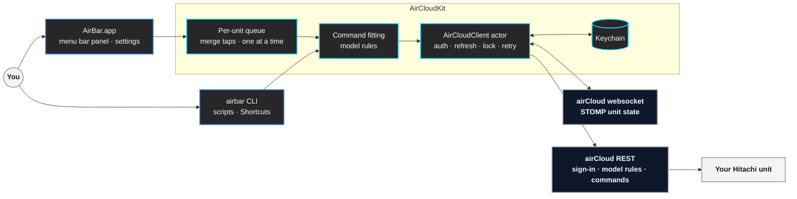

<div align="center">
  

  <br />
  <br />

  <h1> AirBar</h1>

  <p><strong>Your Hitachi air conditioner, from the Mac menu bar.</strong></p>

  <p>
    
    
    
    
    
    
    
  </p>

  <p><a href="https://github.com/Subham12R/airbar/releases/latest"><b>Download for macOS</b></a></p>
</div>

Click the AC icon in your menu bar and your Hitachi air conditioner is right there: power, temperature, mode, fan speed and swing, one click each. No phone, no app to keep open. A small live model of your unit shows what it's doing: the louver opens and sweeps, and airflow streams out in the mode's colour, faster as the fan speeds up.

AirBar talks to the same **Hitachi airCloud Go** cloud service as the official app, signs in with the same phone number or email, and keeps your password in the macOS Keychain. It reads your model's rules from airCloud, so it **only offers settings your unit supports** and never sends one it would reject.

> [!NOTE]
> AirBar is an independent open-source project, not affiliated with, endorsed by or supported by Hitachi, Johnson Controls-Hitachi Air Conditioning or airCloud. It uses an undocumented cloud API that may change. See [docs/API.md](docs/API.md) for what's known about it.

---

##  Screenshots

<div align="center">
  
  &nbsp;
  
  <p><sub>Cooling at 24.5°, in dark and light mode. Temperature moves in your model's steps (here 0.5°).</sub></p>
</div>

<table>
  <tr>
    <td align="center"><br /><sub><b>Dry.</b> Only fan levels this mode allows</sub></td>
    <td align="center"><br /><sub><b>Fan.</b> No temperature, levels 1–5</sub></td>
    <td align="center"><br /><sub><b>Auto.</b> The model's fixed setpoint</sub></td>
  </tr>
  <tr>
    <td align="center"><br /><sub><b>Off.</b> Louver closed, no airflow</sub></td>
    <td align="center"><br /><sub><b>Sign in</b> with phone or email</sub></td>
    <td align="center"><br /><sub><b>Settings.</b> Login item, menu bar, refresh</sub></td>
  </tr>
</table>

---

##  The idea

Hitachi's cloud is picky. Every model has its own modes, fan levels, swing axes and temperature steps; it answers **400** for anything outside them and **429** if a second command arrives before the first is done. A quick remote that just fires requests feels broken. AirBar gets three things right instead:

### 1️⃣ Read the model *(what's allowed)*
On sign-in AirBar fetches each unit's model configuration (`rac-configuration`): which modes exist, the temperature range and step per mode, which fan levels each mode accepts, which swing axes the louver has. The card is built from that, so a cooling-only unit never shows Heat and Fan mode never shows Auto.

> Cached on disk · one request per model · no personal data in the cache

### 2️⃣ Fit every command *(no 400s)*
Before anything is sent, the desired state is fitted to the model's rules: temperature snapped to the step and clamped to the range, a fan level the new mode doesn't allow swapped for that mode's default, an unsupported swing axis mapped to one that exists. The fitting is pure and unit-tested.

> 23.3° → 23.5° · Dry + fan 4 → Auto · "All" swing on a vertical-only louver → Up–Down

### 3️⃣ One at a time *(no 429s)*
Taps change the card instantly, then a per-unit queue merges a burst of taps into **one** command carrying the full state, waits for airCloud to accept it, pauses briefly, and only then sends whatever changed meanwhile. A file lock keeps the app and the CLI in line too.

> Tap + five times → one command for the final temperature · busy units are retried with back-off

---

##  Architecture

One small Swift package: a shared client library, the menu bar app, and a CLI. No helper processes, no Python, no third-party packages.



---

##  Features

| Feature | Description |
| :--- | :--- |
| ** One-click control** | Power, temperature, mode, fan and swing straight from the menu bar |
| ** Model-aware** | Shows only the modes, fan levels, swing axes and temperature range your unit supports |
| ** No rejected commands** | Every command is fitted to the model's rules before it's sent |
| ** Command queue** | Rapid taps merge into one command; units that are still busy are retried, never flooded |
| ** A live model** | The louver opens and sweeps, and airflow follows mode colour and fan speed |
| ** At a glance** | The menu bar icon fills in while a unit runs and can show the set temperature |
| ** Phone or email sign-in** | Same login as airCloud Go; phone accounts use the app's own `mobileNumber` sign-in |
| ** Keychain** | Password and session tokens live in the macOS Keychain, on this Mac only |
| ** Multiple units** | One card per indoor unit in your airCloud home |
| ** CLI** | `airbar` for scripts, Shortcuts, Raycast and Alfred, sharing the app's sign-in and queue |
| ** Native and light** | SwiftUI, about 1 MB, no dependencies, no telemetry |

---

##  Controls

| Control | Does |
| :--- | :--- |
| **Power button** | Turns the unit on or off |
| **− / +** | Target temperature, in your model's steps and range |
| **Mode** | Cool, Heat, Dry, Dry Cool, Fan, Auto (only the ones your unit has) |
| **Fan** | Auto or levels 1–5 (only the ones the current mode allows) |
| **Swing** | Fixed, Up–Down, Side, All (only the axes your louver has) |
| **Refresh** | Re-reads every unit now (it also refreshes on its own, every 45 s by default) |
| **Gear** | Settings: account, login item, menu bar temperature, refresh interval, config file |

**Updating…** on a card means a change is on its way to airCloud.

---

##  Command line

| Command | What happens |
| :--- | :--- |
| `airbar login --phone 9XXXXXXXXX` | Asks for your password (hidden) and signs in with a phone account; `--country 91` is the default |
| `airbar login --email you@example.com` | Same, for an email account |
| `airbar status` | `Living Room: on, cooling 24.5°, fan 2, swing vertical, room 27.5°` |
| `airbar status --json` | Full state of every unit, including its model capabilities |
| `airbar on` · `off` · `toggle` | Power; with several units add `--unit "Living Room"` |
| `airbar set --temp 24.5 --mode cool --fan 2 --swing vertical` | Any mix of settings in one command, fitted to the model |
| `airbar logout` | Signs out and removes the credentials from the Keychain |
| `airbar config` | Prints the config file's path and contents |

The CLI shares the app's Keychain sign-in, config and command lock, so they never step on each other.

---

##  Install a build

1. Download `AirBar-<version>.zip` from the [latest release](https://github.com/Subham12R/airbar/releases/latest), unzip it, and drag **AirBar.app** to Applications.
2. Open AirBar. The build isn't notarized yet, so macOS blocks the first launch: go to **System Settings › Privacy & Security** and click **Open Anyway** (or right-click AirBar › Open).
3. Click the AC icon in the menu bar › **Sign in**, using the same phone number or email as airCloud Go.

Optional: put the CLI on your `PATH` with `sudo install -m 755 airbar /usr/local/bin/airbar`.

Check a download against its checksum with `shasum -a 256 -c AirBar-<version>.zip.sha256`.

---

##  Build from source

### Requirements

- macOS 14 Sonoma or later
- Xcode 16 or later (or the matching Swift toolchain)
- A Hitachi unit set up in **airCloud Go** (Wi-Fi adapter such as SPX-WFG02)

### Getting started

```bash
git clone https://github.com/Subham12R/airbar.git
cd airbar
swift test                        # unit tests, no network
scripts/build-app.sh --native     # dist/AirBar.app (drop --native for a universal build)
open dist/AirBar.app
```

You can also open `Package.swift` in Xcode.

---

##  Configuration

The common options are in **Settings › General**. Everything else is in `~/Library/Application Support/AirBar/config.json`, created on first launch (**Settings › General › Open config file**; set `AIRBAR_CONFIG` to use another file). Restart AirBar after editing.

| Key | Default | Meaning |
| :--- | :--- | :--- |
| `apiBaseURL` | `https://api-global-prod.aircloudhome.com/` | airCloud REST server |
| `notificationURL` | `wss://notification-global-prod.aircloudhome.com/…` | airCloud state websocket |
| `userAgent` | `okhttp/4.9.1` | Sent with every request; the API needs an app-like value |
| `refreshIntervalSeconds` | `45` | How often the app re-reads unit state |
| `coalesceMilliseconds` | `450` | Taps within this window become one command |
| `settleSeconds` | `1.2` | Pause after each accepted command before the next |
| `showTemperatureInMenuBar` | `true` | Show the set temperature next to the icon |
| `defaultCountryCode` | `91` | Pre-filled country code for phone sign-in |

---

##  Privacy

- AirBar talks only to airCloud's servers, over HTTPS. No analytics, crash reporting or third-party services.
- Your sign-in and session tokens stay in the macOS Keychain (service `io.github.subham12r.airbar`), on this Mac only.
- `~/Library/Application Support/AirBar/` holds `config.json`, `models.json` (cached model rules, no personal data) and a lock file.

Found a security problem? Please report it privately: see [SECURITY.md](SECURITY.md).

---

##  Troubleshooting

| Problem | Fix |
| :--- | :--- |
| "airCloud didn't recognise that account and password" | Pick **Phone** or **Email** to match how you sign in to airCloud Go. For phone, type the number without the country code. |
| You sign in to airCloud Go with Google or Apple | Those accounts have no password: use **Forgot password** in airCloud Go to set one. |
| "No air conditioners yet" | That login's airCloud home is empty. Add the unit in airCloud Go, or sign in with the account that owns it. |
| "The AC is still busy…" | The unit was still handling the previous command. Try again in a moment. |
| macOS won't open AirBar | See step 2 of [Install a build](#-install-a-build). |

More in [SUPPORT.md](SUPPORT.md).

---

##  Tech stack

| Technology | | Used for |
| :--- | :---: | :--- |
| **Swift · SwiftUI** |  | The menu bar panel, the unit illustration, settings |
| **AppKit · ServiceManagement** |  | Menu bar item, windows, open at login |
| **Security (Keychain)** |  | Storing the sign-in and session tokens |
| **URLSession · WebSocket** |  | airCloud REST calls and the STOMP state socket |
| **Swift Package Manager** |  | One package: `AirCloudKit`, the app and the CLI |
| **XCTest** |  | Sign-in, STOMP parsing, model rules and command fitting |
| **GitHub Actions** |  | Tests and a build on every push; universal releases from tags |

---

##  Development

```bash
swift build                       # everything
swift test                        # 16 tests, no network
scripts/build-app.sh --native     # app bundle + zip in dist/
swift scripts/brand.swift docs/images/panel-dark.png   # regenerate docs/brand/
```

<details>
<summary><b>Demo mode and screenshots</b></summary>

<br />

The app has a demo mode that needs no account. `--preview` opens a screen in a window, screenshots it and quits; every image in this README was made this way.

| Flag | Effect |
| :--- | :--- |
| `--demo` | Use a demo unit instead of airCloud |
| `--demo-mode DRY` | Demo unit in another mode (`COOLING`, `DRY`, `FAN`, `AUTO`) |
| `--demo-fan LV4` | Demo unit fan speed |
| `--demo-off` | Demo unit switched off |
| `--preview out.png` | Screenshot the panel to `out.png` and quit |
| `--settings account\|general\|about` | With `--preview`, screenshot a settings tab instead |
| `--dark` | Dark appearance |

```bash
dist/AirBar.app/Contents/MacOS/AirBar --demo --demo-mode FAN --preview /tmp/fan.png --dark
```

</details>

<details>
<summary><b>Releases</b></summary>

<br />

1. Update `VERSION` and `CHANGELOG.md`, commit.
2. Tag and push: `git tag v$(cat VERSION) && git push --tags`.
3. The release workflow tests, builds the universal app, and publishes `AirBar-<version>.zip` and its `.sha256` with the changelog entry as notes.

</details>

---

##  Project structure

```
Sources/
├── AirCloudKit/        shared library
│   ├── AirCloudClient  actor: sign-in, token refresh, units, model rules, commands, lock, retry
│   ├── CommandFitting  fits a desired state to the model's rules
│   ├── Models          units, capabilities, desired state, sign-in method, errors
│   ├── STOMP           websocket frames
│   ├── Keychain        credential storage
│   └── Config          config.json
├── AirBar/             menu bar app: panel, AC card, illustration, settings, store and queue
└── airbar-cli/         the airbar command-line tool
Tests/AirCloudKitTests/ unit tests (no network)
scripts/                build-app.sh, make-icon.swift, brand.swift
docs/                   API.md, brand/, images/
```

---

##  Docs

| | |
| :--- | :--- |
| [**airCloud API notes**](docs/API.md) | Sign-in (email and `mobileNumber`), the STOMP state socket, model rules, commands, 400/429 behaviour |
| [**Contributing**](CONTRIBUTING.md) | Setup, project layout, guidelines, releases |
| [**Support**](SUPPORT.md) | Getting help and what to include |
| [**Security**](SECURITY.md) | Reporting vulnerabilities, how credentials are handled |
| [**Changelog**](CHANGELOG.md) | What changed in each version |

---

##  Contributing and thanks

Issues and pull requests are welcome, especially reports from other Hitachi models: the output of `airbar status --json` helps AirBar support more units. Start with [CONTRIBUTING.md](CONTRIBUTING.md) and the [Code of Conduct](CODE_OF_CONDUCT.md).

Earlier community work on the airCloud API made this much easier:
[svmironov/aircloud_ha](https://github.com/svmironov/aircloud_ha),
[mdlnvere/AircloudGo-Homey-module](https://github.com/mdlnvere/AircloudGo-Homey-module),
[lb544/ha-aircloud](https://github.com/lb544/ha-aircloud) and
[nogic1008/ha_aircloudhome](https://github.com/nogic1008/ha_aircloudhome).

---

##  Built by

| | | |
| :---: | :--- | :--- |
|  | **Subham Karmakar** | [@Subham12R](https://github.com/Subham12R) |

Released under the [MIT License](LICENSE).

---

<p align="center">
  <br />
  <sub>Made on a Mac, for the menu bar. Cool air, one click away.</sub>
</p>
